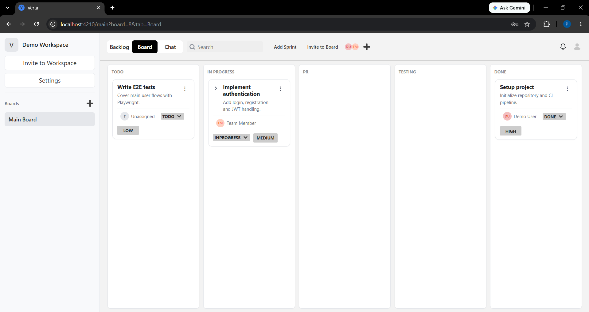
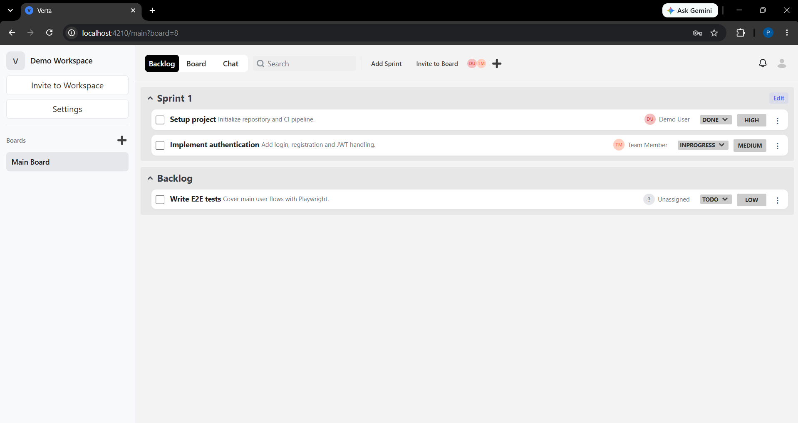
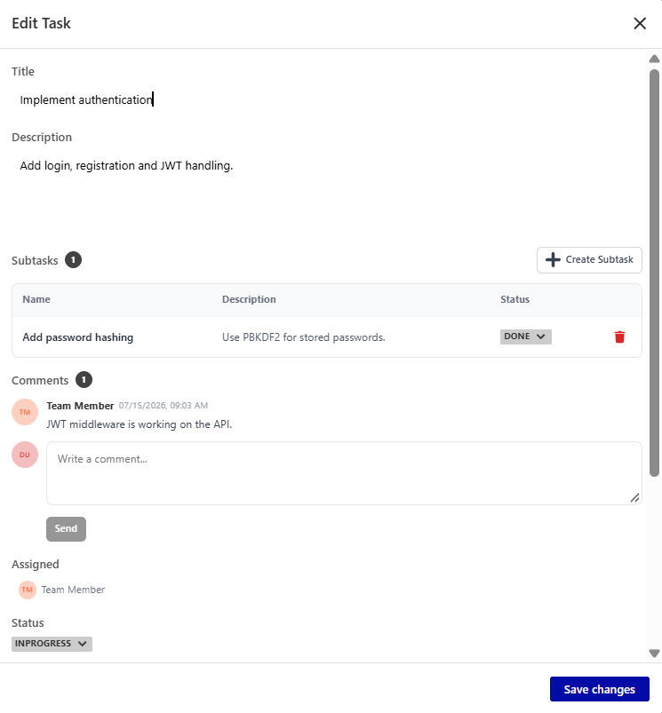
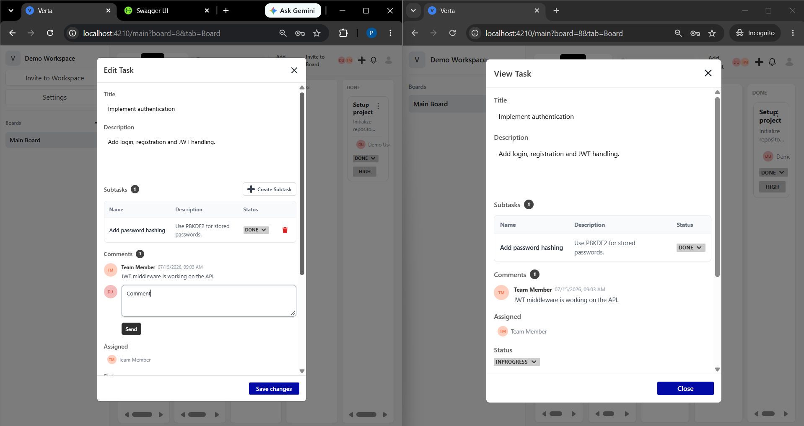
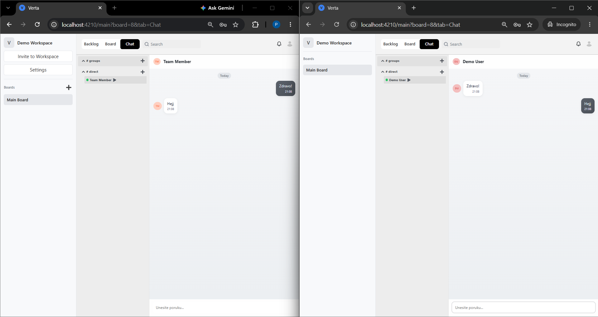
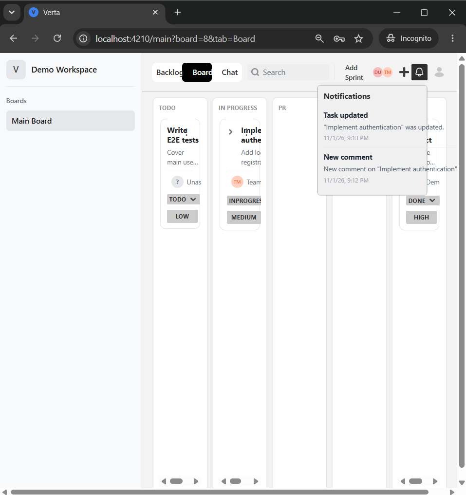

# Verta

A Jira-style project management tool for teams: workspaces, boards, sprints and a Kanban board, tasks with subtasks, comments and attachments, real-time chat and notifications – with **collaborative editing protected by task locks**, so two people never overwrite each other's changes.


> Team project developed for the *Software Architecture and Design* course at the Faculty of Electronic Engineering, University of Niš.

## Screenshots

**Kanban board** – tasks move through `TODO → IN PROGRESS → PR → TESTING → DONE`



| Backlog and sprints | Task details – subtasks and comments |
|---------------------|--------------------------------------|
|  |  |

**Task locking** – the first user to open a task gets write access (*Edit Task*), everyone else opens it read-only (*View Task*) until the lock is released



| Real-time chat | Notifications |
|----------------|---------------|
|  |  |

<details>
<summary><b>API (Swagger)</b></summary>


</details>

## Features

- **Workspaces and boards** – create workspaces, invite members, create boards and invite people to them
- **Backlog and sprints** – plan sprints, move tasks between the backlog and a sprint
- **Kanban board** – five-stage workflow (To Do, In Progress, PR, Testing, Done) with priorities and assignees
- **Tasks** – description, subtasks with their own status and priority, comments, file attachments with preview
- **Collaborative locking** – pessimistic locks on tasks and boards with heartbeats, automatic expiry and a waiting queue
- **Real-time updates** – board changes, comments and lock transfers are pushed to every connected user via SignalR
- **Notifications** – personal inbox for task updates, new comments and invitations
- **Chat** – direct and group conversations with unread counters and online presence
- **JWT authentication** with hashed passwords

## Architecture

The backend follows a **layered architecture**:

```text
API              → Controllers, SignalR hub, DTOs, global exception middleware
Application      → Services, commands, interfaces (repositories, services, messaging)
Domain           → Entities, enums, states, commands, observers, domain event names
Infrastructure   → EF Core (PostgreSQL), repositories, Unit of Work, RabbitMQ,
                   SignalR notifications, background services, file storage
Shared           → Helpers (JWT, password hashing, mapping)
```

```text
Angular 19 ──HTTP / JWT──► ASP.NET Core Web API ──► PostgreSQL (EF Core)
     ▲                              │
     │                     DomainEventSubject (Observer)
     │                     ┌────────┴─────────┐
     └──── SignalR ◄── SignalR observer   RabbitMQ observer ──► RabbitMQ exchange
                                                                     │
                                          IntegrationEventConsumerService ◄─┘
                                          (persists domain event log, handlers)
```

### Task and board locking

Concurrent editing is solved with **pessimistic locks**:

1. Opening a task requests a lock. If it is free, the user gets write access for 30 seconds.
2. While the task is open, the client sends **heartbeats** that extend the lock.
3. Other users open the task read-only and are registered as **interested** in it.
4. When the owner closes the task, or the lock expires, it is **promoted** to the next interested user, who receives a real-time `YouNowHaveWriteAccess` event.
5. Background services (`WorkItemLockExpiryService`, `BoardLockExpiryService`) check every 10 seconds for expired locks and stale interests.

Boards use the same mechanism with an explicit waiting queue.

### Design patterns

| Pattern | Usage |
|---------|-------|
| **State** | Task workflow – `ToDoState`, `InProgressState`, `PRState`, `TestingState`, `DoneState` define the allowed transitions |
| **Command** | Every task, subtask, comment and file operation is a command (`CreateWorkItemCommand`, `ChangeWorkItemStatusCommand`, `AddCommentCommand`…) executed through a `CommandInvoker` with logging |
| **Observer** | `DomainEventSubject` notifies observers – one pushes events to clients over SignalR, another publishes them to RabbitMQ |
| **Repository + Unit of Work** | Generic and specific repositories behind interfaces, committed through a single unit of work |
| **Background services** | Lock expiry and RabbitMQ consumers run as hosted services |

## Testing

| Suite | Tool | Tests | What it covers |
|-------|------|------:|----------------|
| Component tests | NUnit + Moq | 54 | Commands and services (work items, comments, sprints, workspaces, locks) in isolation |
| API tests | Playwright + NUnit | 16 | REST endpoints end-to-end against a running backend |
| E2E tests | Playwright + NUnit | 15 | User flows in the browser – board, tasks, subtasks, comments, sprints, workspaces |

```bash
# component tests
dotnet test Tests/ComponentTests

# API and E2E tests (backend and frontend must be running)
dotnet test Tests/PlaywrightTests
```

Playwright settings (API and frontend URLs, test user) are in `Tests/PlaywrightTests/appsettings.json`.

## Tech Stack

| Layer | Technologies |
|-------|--------------|
| Frontend | Angular 19, Angular CDK, SCSS, SignalR client |
| Backend | ASP.NET Core (.NET 10) Web API, SignalR, JWT, Swagger |
| Database | PostgreSQL 17, Entity Framework Core (code-first migrations) |
| Messaging | RabbitMQ |
| Testing | NUnit, Moq, Playwright |
| DevOps | Docker, Docker Compose, pgAdmin |

## Getting Started

### Prerequisites

- [Docker Desktop](https://www.docker.com/products/docker-desktop/)
- [Node.js](https://nodejs.org/) 18 or newer
- [.NET 10 SDK](https://dotnet.microsoft.com/download) – only for running tests or the backend outside Docker

### 1. Start the backend, database and RabbitMQ

```bash
docker compose -f infra/docker/docker-compose.yml up -d --build
```

| Service | URL |
|---------|-----|
| API | `http://localhost:8080` |
| Swagger | `http://localhost:8080/swagger` |
| RabbitMQ management | `http://localhost:15672` (guest / guest) |
| pgAdmin | `http://localhost:5050` |

The database schema is created by EF Core migrations, and demo data is seeded automatically in development.

### 2. Run the frontend

```bash
cd frontend
npm install
npx ng serve --port 4210
```

Open `http://localhost:4210` and sign in with a demo account:

| Email | Password |
|-------|----------|
| `demo@verta.com` | `Demo1234!` |
| `member@verta.com` | `Demo1234!` |

> All credentials in `appsettings.json` and `docker-compose.yml` are local development defaults.

## Project Structure

```text
verta/
├── backend/                # ASP.NET Core Web API (API, Application, Domain, Infrastructure, Shared)
├── frontend/               # Angular 19 client
├── Tests/
│   ├── ComponentTests/     # NUnit + Moq
│   └── PlaywrightTests/    # API and E2E tests
├── infra/docker/           # Dockerfile and docker-compose (API, PostgreSQL, RabbitMQ, pgAdmin)
├── documents/              # Architecture and design documentation (Serbian)
└── docs/screenshots/       # README images
```

## Team

- **Petar Nikolić** – [@petarNi](https://github.com/petarNi) – backend
- **Luka Dimić** – [@dimicl](https://github.com/dimicl)
